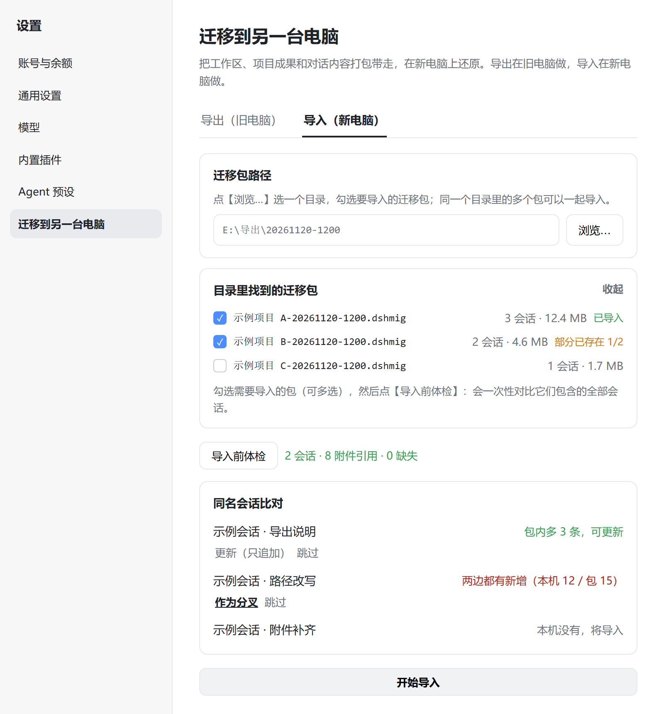

# dsh-workspace-migrate

[](https://www.npmjs.com/package/dsh-workspace-migrate)
[](https://www.dshplugin.store/plugin/lij0000-arch/dsh-workspace-migrate)
[](https://dshopen.org/plugins/dsh-workspace-migrate)
[](https://github.com/lij0000-arch/dsh-workspace-migrate/releases)
[](LICENSE)

把一台电脑上的 **工作区、对话记录、项目文件** 打包带走，在另一台电脑上还原，接着聊。

不是复制 `~/.dsh` 目录——会话通过 Harness 的官方服务重建，所以新机器上的侧栏、标题、归档状态、附件引用都是正常的，而不是一堆打不开的文件。

> 官方仓库：**https://github.com/lij0000-arch/dsh-workspace-migrate**。npm 包名 `dsh-workspace-migrate` 仅由本仓库发布；其它同名仓库是该项目的派生版本。

## 安装

```bash
# 桌面端（大多数情况）
dsh plugin add dsh-workspace-migrate

# 指定 profile
dsh plugin --profile desktop add dsh-workspace-migrate
```

装完在 **设置 → 迁移到另一台电脑** 里使用。要求 DSH `>=0.2.1-rc.2 <0.3.0 || >=0.2.2-rc.1 <0.3.0`。

## 三步迁移


**① 旧电脑导出**：勾选要带走的工作区 → 选**目标系统**（另一台是 Mac 就选 macOS，路径分隔符和非法文件名会自动处理）→ 开始导出。

导出结果是一个目录，每个项目一个 `.dshmig` 文件（其实是个 ZIP），连同项目文件一起打包。

**② 拷过去**：U 盘、网盘、局域网都行。



**③ 新电脑导入**：点【浏览…】选目录 → 勾选要导入的包（可多选）→ 填【导入到】→ 点【导入前体检】看结论 → 开始导入。


导入完成后**完全退出 DSH 再打开**（含托盘），侧栏和缓存才会完全刷新。

## 几种常见情况

**旧电脑还在用，想同步最新进展。**
用【增量更新已有迁移包】刷新同一个包，再导入到新电脑。同名会话会自动走「更新（只追加）」，只把新事件接到尾部；项目文件也按文件增量复制，不会覆盖你新电脑上改过的文件（除非勾选「目标目录非空时仍覆盖」）。

**两边各聊了一段，内容分叉了。**
体检会标出「两边都有新增」，你可以选【作为分叉】：两边内容都保留，新分支以官方分叉会话的形式挂在原会话下。

**目标会话正在用。**
DSH 的会话日志同一时间只允许一个写入者。目标会话开着或正在跑时追加会被拒绝，插件会重试并提示「请关闭该会话后重新导入」。

**导错了。**
底部有【撤销这次导入】：把这次**新建**的项目和会话移到 `~/.dsh/trash/`，可以手工找回。追加过的会话内容不会回退，所以导入后只要在会话里继续聊过，撤销按钮就会变灰。

## 能力与边界

**会在本地做的事**

- 读 `~/.dsh` 里的工作区登记与会话日志，读出项目文件、附件
- 导入时通过 `sessionPersistence` / `workspaceRegistry` 重建，不直接改数据库文件
- 路径改写：把旧机器的绝对路径换成新路径，否则续聊时模型会去找不存在的文件

**不会做的事**

- **不联网**：没有上传、没有遥测、没有远程接口，所有操作都在本机完成
- **不迁移凭据**：`~/.dsh/.credentials.yaml` 不进包，新机器需要重新登录
- **不执行安装**：插件清单只是文字，安装命令由你在对话里确认后执行
- **不删除会话**：DSH 没有删除 API；撤销只是移到 `~/.dsh/trash/`

**已知限制**

- 日志格式有方向性：旧版导出的包可以被新版导入，反过来不行；两台机器版本差得越多，越建议先统一版本
- 子代理会话不带（它们在 DSH 里本来就不显示）
- 跨系统的自动化测试覆盖了路径改写、分隔符转换、Windows 非法文件名清洗，但真机只有 Windows 验证过；迁到 Mac/Linux 建议先小批量试
- 体检的准确性依赖【导入到】目录：留空时路径比对只能用启发式，带空格的旧路径可能被判成「两边都有新增」

## 致谢

这个插件的不少改进来自使用者的反馈，感谢他们：

| 贡献 | 内容 |
|---|---|
| [@xinink](https://github.com/xinink) | 报告 Web 引导阶段插件加载失败（[#2](https://github.com/lij0000-arch/dsh-workspace-migrate/issues/2)），定位到 `inject` 未声明的 `uiWorkspace` 读取，已在 0.8.3 修复 |

> 报告缺陷或提出建议被采纳后，会记在这里，同时写进对应版本的 Release 说明。

## 支持这个项目

这个插件是按用户反馈持续优化的：遇到问题、想要什么功能，直接发邮件到 **lij0000@sina.com**，不用客气。

如果迁移帮你省下了半天时间，也可以请我喝杯咖啡 ☕ —— [爱发电](https://afdian.com/a/J-Lee)。

赞助是纯自愿的：它不改变 MIT 许可，也不解锁任何私有功能。这个插件的全部能力都在这份代码里。

## 开发

- `index.js`：Host 半边。注册 `sessionPersistence` / `workspaceRegistry` / `webServer`，在 `/api/dsh-migrate` 下提供 `inventory` / `bundle-info` / `scan` / `preview` / `check` / `export` / `import` / `task` / `rollback` / `cleanup` / `setup-workspace` / `last-import`
- `client.js`：Client 半边。注册 `settings.section` 的 `migration` 页签，纯 React 无构建

本地自检脚本（不随包发布，在开发者的 `_publish/` 目录）：

```bash
node _publish/check-routes.mjs dsh-migrate/index.js      # 每个路由必须有响应
node _publish/client-smoke.mjs dsh-migrate/client.js     # 客户端渲染冒烟
node _publish/pure-functions-test.mjs dsh-migrate/index.js
node _publish/crossos-test.mjs dsh-migrate/index.js      # 跨系统目录包端到端
node _publish/crossos-zip-test.mjs dsh-migrate/index.js  # 归档包 + 非法文件名
node _publish/append-decision-test.mjs dsh-migrate/index.js
node _publish/append-lock-test.mjs dsh-migrate/index.js
node _publish/resequence-test.mjs dsh-migrate/index.js
node _publish/files-incremental-test.mjs dsh-migrate/index.js
```

## License

MIT
