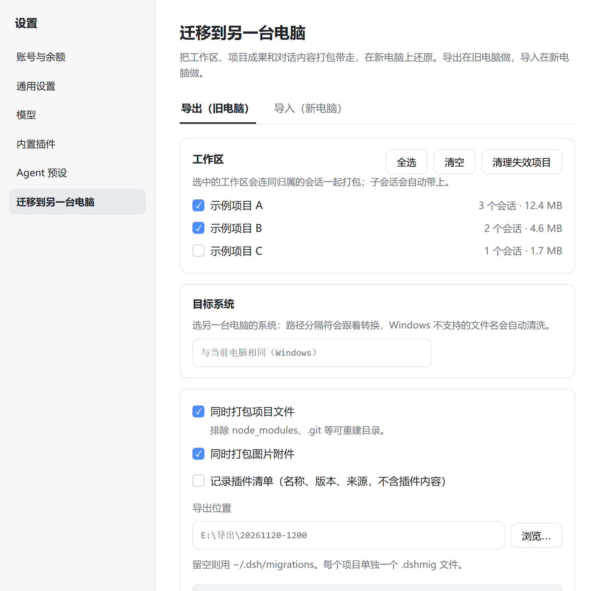

# dsh-workspace-migrate

[](https://www.npmjs.com/package/dsh-workspace-migrate)
[](https://www.dshplugin.store/plugin/lij0000-arch/dsh-workspace-migrate)
[](https://dshopen.org/plugins/dsh-workspace-migrate)
[](https://github.com/lij0000-arch/dsh-workspace-migrate/releases)
[](https://github.com/lij0000-arch/dsh-workspace-migrate)
[](LICENSE)

换电脑，把 DeepSeek Harness 里的**项目、对话、文件和插件清单**一起带走，而且搬过去的旧对话还能接着聊。

> 已被 [awesome-dsh-plugin](https://awesome-dsh-plugin.com/zh/p/lij0000-arch/dsh-workspace-migrate/) 收录 · npm 周下载 1,000+ · 适配 DSH 0.2.2（含 rc 预发布）

> ⚠️ **安全下限 0.5.3**：0.5.2 及更早版本的本地接口只做了同源检查，缺少宿主身份认证；0.5.3 起每个请求都过 `ctx.connection` 凭据校验，无认证服务时直接返回 503。
>
> 📦 **推荐 0.7.0 及以上**：两边都有新消息时用**分叉会话**合并、常驻「撤销上一次导入」、自动跳过子代理会话。

**和别的迁移工具不一样的四点：**

- **按工作区选**，不是整机全量：勾哪个项目就带走哪个项目的会话、归属、置顶/归档、文件和附件。
- **指定新根目录**：导入时填一个目录，每个项目自动建 `<根>/<项目名>`，并把历史对话里的旧绝对路径**重写**成新路径——这是「搬过去就能接着聊」的关键。
- **增量同步**：之后想再同步一次，只复制改动的文件，没变化的会话直接复用。
- **插件清单**：顺带记录旧电脑装过哪些插件，新电脑上可以一键生成一个「安装会话」，让 agent 带着你看得见的命令去装。

## 安装

```bash
# 桌面端（大多数情况）
dsh plugin --profile desktop add dsh-workspace-migrate
```

不想用命令行：设置 → 插件 里安装，或在一个对话里让 agent 用 `plugin_manager` 装这个仓库。装完刷新页面，**设置 → 迁移** 出现即可用。

> 插件按 profile 隔离：**你现在用的界面是哪个 profile，就装到哪个**。装错的表现是「装好了，但设置里看不到这个页签」。桌面端一般是 `desktop`，`dsh web` 是 `web`；不确定就执行 `echo $env:DSH_PROFILE`。

## 怎么用（两步）

1. **旧电脑**：设置 → 迁移 → 导出（旧电脑）→ 勾项目 → 开始导出，得到一个文件夹，拷到新电脑。
2. **新电脑**：设置 → 迁移 → 导入 → 选包 → 填**新根目录** → 导入前体检 → 开始导入。



完成后刷新页面，项目、对话、文件都在新位置，旧对话可以继续。

## 用之前先知道

迁移包是**文件夹**，不是压缩包；拷走整个文件夹即可（U 盘、网盘、局域网都行）。两边机器需要装同一个插件；导出时插件会把自己复制进迁移包的 `plugin/dsh-migrate/`，新电脑上也能从这个目录装。

## 能力与边界

- **读**：`~/.dsh/sessions`（会话事件流）、`~/.dsh/storages/workspace.json`（项目登记、置顶/归档集合）、`~/.dsh/attachments`、以及所选项目目录
- **写**：经公开服务新建会话与项目登记（`sessionPersistence` / `workspaceRegistry`）、按路径映射复制项目文件与附件
- **删**：不删任何东西。撤销导入只会移除**那次导入新建**的项目登记，并把会话移到 `~/.dsh/trash/`（可恢复），其它 id 一律拒绝
- **网络**：不向外发起请求；仅在本机 `127.0.0.1` 注册 `/api/dsh-migrate` 供当前页面调用
- **鉴权**：每个请求都经宿主 `ctx.connection.requestRejection()` 校验浏览器签名凭据，被拒返回 401/403；宿主没有该服务时**直接返回 503**，不回退到 Origin/Host 比较（请求头可以伪造，不能当身份凭据）
- **凭据**：不读取、不导出 `~/.dsh/.credentials.yaml`
- **隐私**：迁移包含完整对话与项目文件，导出目录不要放在公开位置

## 旧电脑：导出

1. 设置 → 迁移 → **导出（旧电脑）**
2. 勾选要带走的工作区（默认全选），按需勾选「同时打包项目文件」「同时打包图片附件」「同时记录已装插件清单」
3. 导出位置留空则写到 `~/.dsh/migrations/<项目名>-<日期>-<时间>/`（多个项目时是 `dsh-migration-<日期>-<时间>`）；旁边的【浏览…】可以直接选目录
4. 完成后把整个文件夹拷到新电脑

包里的项目文件按 `files/<项目名>-<日期>/` 分目录存放，不用打开 JSON 也能看出哪个文件夹是哪个项目。

不带项目文件时只打包对话；带项目文件时按目录排除 `node_modules`、`.git`、`.venv`、`__pycache__` 等可重建目录。

附件**只打包所选会话真正引用到的那些**：`~/.dsh/attachments` 是全机共享的，一条会话可能只用到其中几张图，整目录照搬会把几百 MB 无关文件塞进包里。

## 增量同步（0.2.0+）

第一次导出之后，可以让同一个迁移包保持最新，而不是每次整包重拷：

- 设置 → 迁移 → 导出 → **增量更新已有迁移包**，从列表选一个包，或直接填包的路径
- 只复制**新增或修改过**的文件；源里删掉的文件会同步从包里删除
- 会话按其源日志的字节数与事件数判断：没变化的会话直接复用，不重新编码
- 增量范围固定为这个包原本包含的工作区，不会把别的项目卷进来

实测：改 1 个 / 删 1 个 / 加 1 个 → `copied=2 removed=1 unchanged=0`；紧接着再跑一次 → `copied=0 unchanged=2`；空闲会话 → `reused=1`、`sessionBytes=0`。

判断变更用「文件大小 + 修改时间」：内容变了但大小和时间都没变的文件不会被识别（正常编辑不会出现）。

## 新电脑：导入

1. 装好 DSH，从迁移包的 `plugin/dsh-migrate/` 安装本插件
2. 设置 → 迁移 → **导入（新电脑）**
3. 选择迁移包（【浏览…】可直接选文件夹），读取清单
4. 填**导入到（新工作路径）**，比如 `E:\DSH`：每个项目会自动建在 `E:\DSH\<项目名>` 下，目录不存在就创建
5. 每行的目标路径是算好显示的；想单独改某个项目就点【修改路径】，改过的行可以点【恢复默认】
6. 勾选**重写对话里提到的旧路径**（默认开）
7. 开始导入；结束后看报告里的导入数、重写数、未归属数和提醒

### 为什么要重写旧路径

会话历史里的工具调用、文件引用、报错信息都写着旧机器的绝对路径（`D:\...`）。只改工作目录不改这些，续聊时模型会去找不存在的文件——这就是「对话变乱」的根因。导入时会把被重映射的根路径在事件数据里整体替换成新路径，并报告替换了多少处。

实测：把 `D:\Deepseek Workspace migration` 迁到 `D:\...\_rt\root\Deepseek Workspace migration` → 报告 `rewritten=1054`，导出后检查会话内容确认工具调用、`cwd`、文件引用都指向新根。

导入通过 Harness 的公开服务（`sessionPersistence` / `workspaceRegistry`）重建，不是覆盖文件，所以：

- 同名会话按「导入前体检」给的结论各自处理，见下一节
- fork 出来的会话会把父会话前缀展开成独立会话
- **子代理会话自动跳过**：它们是机器内部记录，DSH 本来就不显示，带过来只会变成一堆打不开的「未命名」
- 归档/置顶状态会尽量恢复
- 导入错了可以「撤销上一次导入」，见下文
- 报告里的「未归属项目的会话」表示该会话的 cwd 不落在任何项目目录，检查一下路径映射即可

## 同名会话：追加、分叉还是跳过（0.7.0+）

两边都有同一个会话时，导入前体检会逐条给出结论，你只需要决定「怎么做」：

| 结论 | 含义 | 可选项 |
|---|---|---|
| 完全一致 | 逐条事件相同 | 跳过 |
| 包内更新 | 本机是包里内容的前缀 | **追加**（只把新事件接到本机日志尾部）/ 跳过 |
| 本机更新 | 包里是本机内容的前缀 | 跳过（本机更全） |
| 两边都有新增 | 共同前缀之后各自长出了不同内容 | **作为分叉** / 跳过 |

「作为分叉」是把共同前缀原样留在本机会话里，把包里那条分支接成**官方分叉会话**：header 带 `parentSession` 与 `isSeeded`，日志里有 `session/end-seed` 标记，侧栏里挂在原会话下面。两条路都保留，谁都不丢。

实现上做了三件容易被漏掉的事：把分叉点之后事件的 `seq` 整体后移并同步 `throughSeq` / `messageSeqs` 等引用；把尾部事件里的会话自引用换成新 id（否则读日志会报 `delivery marker names the wrong Session`）；`create()` 时必须传 `inheritedEventCount`。写入后会立刻回读一遍，读不出来就删掉该分叉并如实报告。

## 撤销上一次导入（0.7.0+）

导入成功后，导入页底部会常驻一张「上一次导入」卡片，记录写在 `~/.dsh/migrations/last-import.json`，关掉设置再打开、重启 DSH 都还在。

- 只处理**那次导入新建**的项目登记与会话，复用的已有项目不动
- 会话不是删除，而是移到 `~/.dsh/trash/undo-import-<时间>/`（同卷 `rename`，带 `MANIFEST.json`），可以手工恢复
- **导入后只要在某些会话里继续聊过，按钮就变灰禁用**：撤销会丢掉那些新内容，所以宁可不给按

## 插件清单与安装会话（0.6.0+）

迁移包可以顺带记下旧电脑装了哪些插件（`plugins.json`），只记**名称、版本、来源**，不含插件内容。

导出时可以选择不记录，或者逐个取消——这份清单本身也算信息（它说明你用什么工具）。

新电脑的导入页会列出这份清单：

- **npm / git / 压缩包**：给一条 `dsh plugin --profile <profile> add …` 命令，可复制到终端执行
- **本地链接（`link:`）**：灰掉不可选，因为它指向旧电脑的路径，搬不过去
- **官方插件（`@deepseek-ai/*`）**：只显示版本，用来对比两台机器的 DSH 差异

点【一键创建安装会话】会：

1. 在专用工作区 `~/.dsh/plugin-setup`（侧栏显示「插件安装」）里新建一个会话
2. 把勾选的插件写成提示词填进输入框
3. **你自己按发送**，由 agent 在对话里逐条执行，每条命令你都看得见、随时可以打断

插件本身**不执行任何安装动作**——它只生成一段文字。这样即使迁移包被人动过手脚，最终执行的也是你在对话里看得到、可以当场反悔的命令。

## 导入前体检

会话里引用过的图片/文件如果在新机器上不存在，续聊时请求会在准备阶段失败（表现为「DeepSeek Messages transport failed」）。导入页的 **导入前体检** 会先把包里每个会话的附件引用扫一遍，对照本机 `~/.dsh/attachments` 报告缺多少、涉及哪些会话。

```
1 个会话 · 37 个附件引用 · 6 个缺失
建议：包内带了 attachments 目录，勾选「包含图片附件」即可补齐
• session-xxxx — 6/37
```

导入时若没勾选附件、且会话确实有缺失，报告里也会写「缺失附件的会话: N」。修法：把旧机器的 `~/.dsh/attachments` 整个拷到新机器同名位置，**重启 DSH**，这些会话即可续聊（附件引用是内容寻址的，文件到位就解析得到）。

## 清理失效项目

导出页的「清理失效项目」会删掉**路径已不存在且没有任何会话**的项目登记。用于导入后目标目录被移动或删除的情况。

## 限制

- **日志格式有方向性**：旧版本导出的包可以被新版本导入（后端会自动迁移），反过来不行。两台机器的 DSH 版本差距越大，越建议先把旧机升级到同一版本再导出。
- **凭据不迁移**：`~/.dsh/.credentials.yaml` 不在包里，新电脑需要重新登录。
- **插件不自动装**：迁移包会记录旧电脑的插件清单，新电脑上用【一键创建安装会话】让 agent 装；本地链接（`link:`）的插件无法迁移，需要手动处理。
- 导出目录不能落在被导出的项目里面；这种情况会跳过该项目的文件并给出提醒。

## 开发

- `index.js`：Host 半边。注册 `sessionPersistence` / `workspaceRegistry` / `webServer`，在 `/api/dsh-migrate` 下提供 `inventory` / `preview` / `check` / `export` / `import` / `task` / `rollback` / `cleanup` / `setup-workspace`。
- `client.js`：Client 半边。注册 `settings.section` 的 `migration` 页签，纯 React 无构建。
- 改完 `index.js` 需要在插件页把本插件关掉再打开，模块才会重新加载；`client.js` 一般刷新页面即可。
